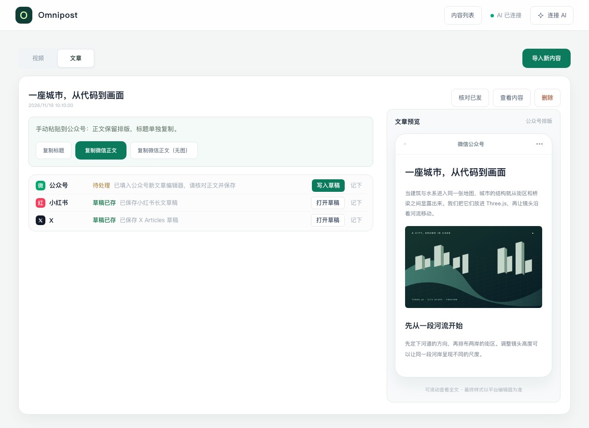
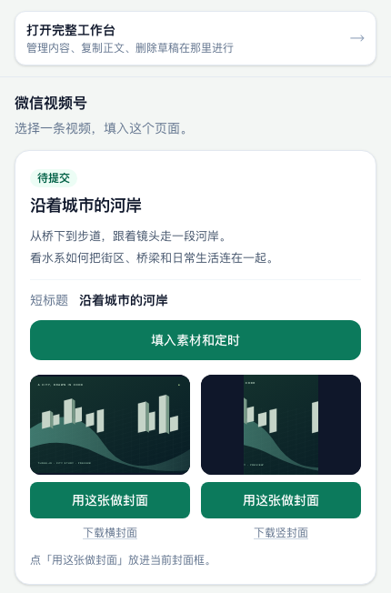
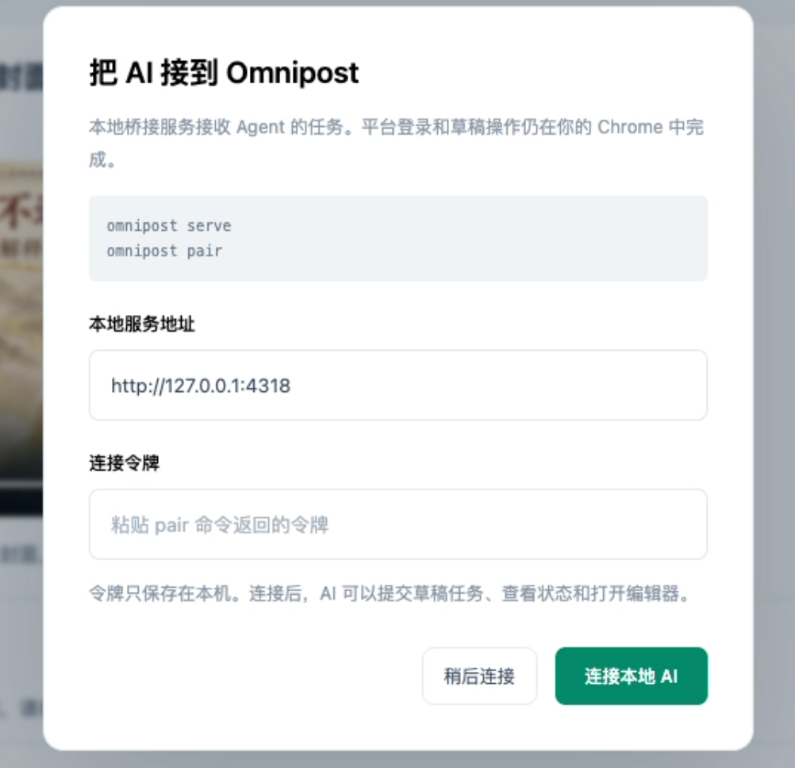

# Omnipost

Omnipost 是本地 Chrome 扩展和命令行工具。导入 Markdown 文章或视频后，可以为各平台单独调整文案、准备草稿、在当前发布页填充素材，或为视频设置平台原生定时。工作台集中显示每个平台的进度和下一步操作。

- **视频定时**覆盖小红书、抖音、微信视频号和 B 站。小红书、抖音支持显式授权后提交预约，视频号、B 站可填入定时并在原页面确认。
- **文章与视频草稿**支持小红书和 X。微信公众号支持新版文章编辑器填充，以及复制带排版的正文和配图。
- **视频素材填充**支持横竖封面和逐平台文案。侧栏还能在当前平台页放入封面或更换 YouTube 缩略图。
- **任务追踪**按视频 SHA-256 合并工作台卡片，保留各次任务的排期和结果。定时已填入、收到平台回执和作品已发布分别显示。


_当前版本工作台，使用示例素材与任务状态。_

## 平台能力

| 平台       | 文章                                             | 视频与封面                                 | 原生定时                                |
| ---------- | ------------------------------------------------ | ------------------------------------------ | --------------------------------------- |
| 微信公众号 | 新版文章编辑器填标题、正文和配图，也可复制富文本 | —                                          | —                                       |
| 小红书     | 保存和恢复原生长文草稿                           | 保存和恢复视频草稿，支持 3:4 封面          | 填写，显式授权后提交                    |
| X          | 保存和恢复 Articles 草稿，需账号具备资格         | 保存和恢复视频帖子草稿                     | —                                       |
| 微信视频号 | —                                                | 侧栏填视频、描述、短标题和横竖封面         | 侧栏填写，在平台提交                    |
| 抖音       | —                                                | 填完整简介、话题和横竖封面                 | 填写，显式授权后提交                    |
| 哔哩哔哩   | —                                                | 上传页填文案、标签和封面，可指定分区       | 填写，在平台核对 4:3 与 16:9 封面后提交 |
| YouTube    | —                                                | 上传后由 Studio 存为私享，侧栏可更换缩略图 | —                                       |
| Instagram  | —                                                | 在创建弹窗填入视频与配文，有入口时可填封面 | —                                       |

小红书和 X 的草稿保存与恢复已有真实账号记录。公众号新编辑器、YouTube 和 Instagram 的当前适配以模拟验证为主。各平台行为和验证范围见 [平台能力与限制](docs/capabilities.md)。

## 安装

需要 Node.js 22 或更新版本、pnpm 和 Chrome。在仓库根目录运行：

```sh
pnpm install --frozen-lockfile
pnpm build
```

在 Chrome 打开 `chrome://extensions/`，启用开发者模式，选择「加载已解压的扩展程序」，选中构建生成的 `dist` 目录。点击工具栏中的 Omnipost 图标打开工作台或当前平台侧栏。

本地预览可运行 `pnpm preview`，打开 [工作台预览](http://127.0.0.1:4192/workbench.html?demo=1)。

## 工作台与侧栏

- **文章**可导入 Markdown 和本地配图，也可从文章文件夹选稿。工作台提供公众号排版预览和「复制标题」「复制微信正文」「复制微信正文（无图）」。在公众号草稿箱通过「新的创作 → 文章」打开新版编辑器后，也可从侧栏填入正文，核对后在公众号保存。
- **视频**可在工作台导入视频和横竖封面，逐平台调整标题、简介和标签。用「打开发布页」进入平台，再从侧栏填入当前页。已打开平台封面窗口时，可直接用侧栏把图片放进对应的封面框。
- **核对已发**会在已加载的作品列表中匹配唯一标题，并读取可见的点赞数。同名条目会提示人工核对，明确显示的预约或审核状态会保留在结果里。也可点「记下」手动登记。



_文章工作台示例。右侧可滚动查看公众号排版，左侧保留复制和平台操作。_



_视频号侧栏示例。选择视频后可填入素材和定时，也可单独使用或下载横竖封面。_

<details>
<summary>查看视频号实际填充截图</summary>


截图记录的是上传与填写过程。封面、声明和提交结果以该平台页面为准。

</details>

## CLI 与 Agent

在仓库根目录启动桥接。在另一终端运行 `pair`，把令牌填入工作台的「连接 AI」，再检查连接：

```sh
node cli.mjs serve
# 在另一终端执行
node cli.mjs pair
node cli.mjs doctor
```

Chrome 和本地服务都在运行时，扩展会使用已保存的配对信息连接。桥接令牌和任务数据保存在本机 `.local/`。Agent 可安装仓库附带的 [Omnipost 技能](skills/omnipost/SKILL.md)：

```sh
npx skills add bindoon/omnipost
```

<details>
<summary>查看「连接 AI」界面</summary>



</details>

### 准备草稿或交接素材

```sh
node cli.mjs draft '/绝对路径/文章.md' --platforms wechat,xiaohongshu,x
node cli.mjs video '/绝对路径/视频.mp4' \
  --title '沿着城市的河岸' --description-file '/绝对路径/简介.txt' \
  --cover-landscape '/绝对路径/横封面.jpg' \
  --cover-portrait '/绝对路径/竖封面.jpg' \
  --platforms channels,douyin --stage
```

`--stage` 仅把素材交给扩展，由侧栏填入当前发布页。`--overrides '/绝对路径/平台文案.json'` 可按平台指定 `title`、`description`、`tags`，定时任务可覆盖 `collection`，B 站也支持 `category`。

### 写入视频原生定时

把示例日期换成预约窗口内的实际日期。以下命令把素材和时间交给小红书原生发布页：

```sh
node cli.mjs video '/绝对路径/视频.mp4' \
  --title '沿着城市的河岸' --description-file '/绝对路径/简介.txt' \
  --cover-landscape '/绝对路径/横封面.jpg' \
  --cover-portrait '/绝对路径/竖封面.jpg' \
  --platforms xiaohongshu --collection '城市漫步' \
  --schedule-at 'YYYY-MM-DDT07:00:00+08:00'
```

小红书或抖音任务加 `--submit-scheduled` 后，会在核对文案、横竖封面、合集、声明和预约时间后提交。含 AI 生成内容时可传 `--ai-generated`。视频号通过侧栏填写。B 站可省略合集，并通过 `doctor` 的 `nativeBilibiliSchedule` 检查扩展是否支持该流程。

### 查看结果和继续处理

```sh
node cli.mjs status TASK_ID
node cli.mjs open TASK_ID xiaohongshu
node cli.mjs retry TASK_ID xiaohongshu
```

| 状态                   | 含义                                                      |
| ---------------------- | --------------------------------------------------------- |
| `ready`                | 扩展已接收素材，可在平台页填入。未领取的任务显示 `queued` |
| `draft_ready`          | 有平台保存证据和草稿或编辑入口                            |
| `schedule_ready`       | 预约时间已写入，等待核对和提交                            |
| `scheduled`            | 平台已确认收到预约                                        |
| `schedule_unconfirmed` | 提交结果待核对，先查平台的作品管理                        |
| `needs_attention`      | 打开原页面查看具体提示                                    |

CLI 默认返回 JSON 摘要，加 `--full` 可查看完整任务。重复使用同一 `--id` 会复用任务。省略 ID 时，素材、文案、平台和排期均一致的视频请求也会复用；工作台按视频指纹归组，可展开每次交接。

## 开发与验证

平台规则位于 [`extension/shared/platforms/`](extension/shared/platforms/)。每个平台的模块声明文案约束、页面入口与原生定时能力，CLI、桥接、后台和页面脚本共用这些规则。[运行结构与验收](docs/runtime.md) · [截图来源](docs/images/README.md)

```sh
pnpm test
pnpm format:check
pnpm build
```

自动测试覆盖本机 HTTP 与 WebSocket 桥接、断线恢复、重复请求、定时状态、素材分片和模拟平台编辑器。升级时在 Chrome 重新加载 `dist`，重启本地桥接，再通过 `node cli.mjs doctor` 查看连接与定时能力。

## 许可

[MIT](LICENSE)
