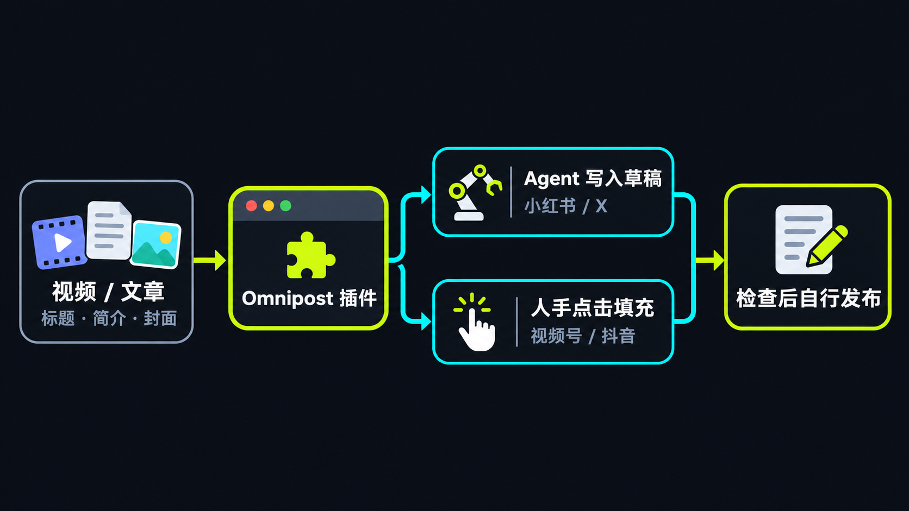
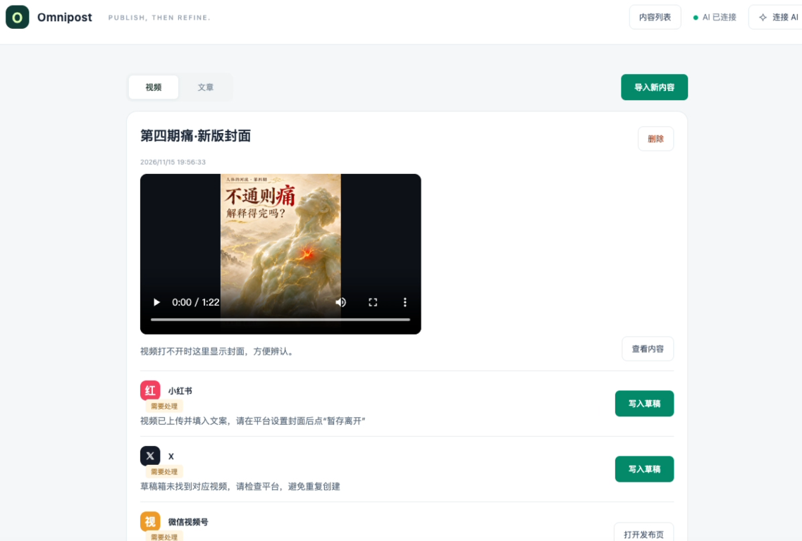
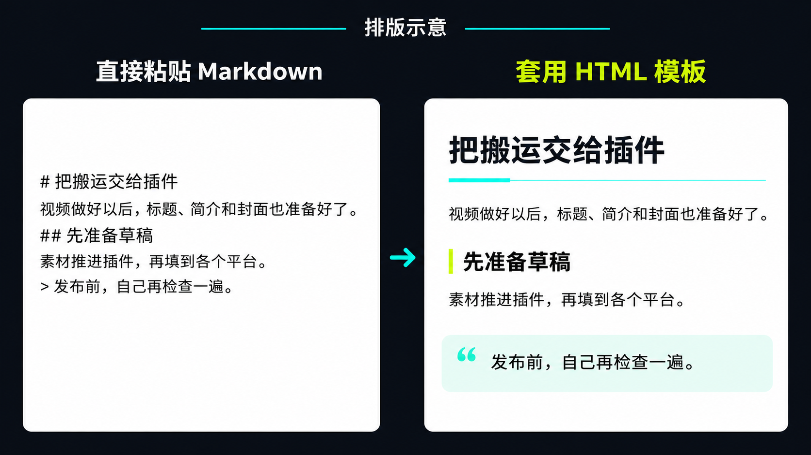
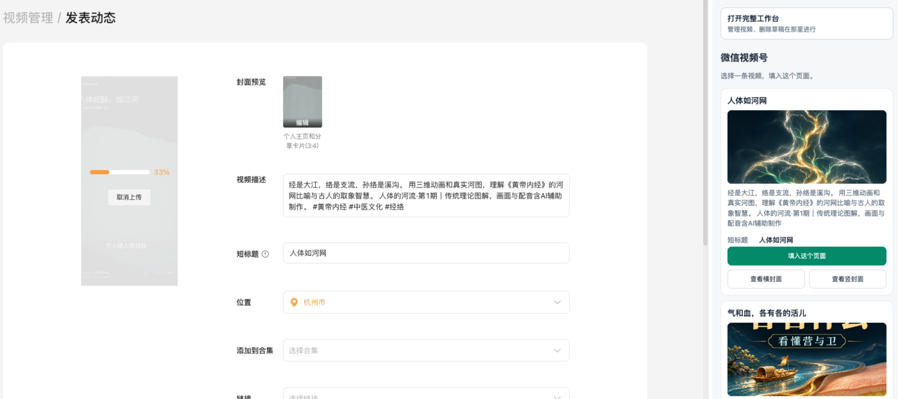

# Omnipost

**写一份内容，在每个平台继续打磨。**


本地 Chrome 扩展，把一篇文章或一条视频交给微信公众号、小红书、X、视频号和抖音。工作台和 CLI 走同一套任务，只处理草稿，不点击公开发布。

Agent 安装：

```sh
npx skills add bindoon/omnipost
```

命令行：

```sh
npx omnipost doctor
```

仓库发布到 npm 之前，在本目录用 `node cli.mjs` 或 `pnpm exec omnipost`。

## 一份素材，两条路径

文章、视频、标题、简介与封面先进入 Omnipost，再按平台选择下一步：小红书和 X 可写入草稿；视频号、抖音由你在发布页点击填充。公众号文章支持新编辑器填充，也可以复制排好版的正文粘贴。最终发布由你确认。



_流程示意。各平台当前可用能力与验证情况见下表。_

## 当前状态

0.1 可以从本仓库构建。本地测试覆盖桥接、素材分片和模拟编辑器。小红书与 X 的图文、短视频草稿曾保存并重新打开；公众号已改用新版文章编辑器填充（真实账号待验收）；视频号已在发表页填入视频、描述和短标题；抖音停在发布页填充。扩展不点击公开发布。能力边界见 [平台能力](docs/capabilities.md)。

平台编辑器会变动；遇到登录、上传、保存证据不足或无法定位控件时，保留平台页面并显示“需要处理”，不把“已填入页面”报告成“草稿已保存”。

| 内容        | 微信公众号         | 小红书                 | X                                 | 视频号         | 抖音           |
| ----------- | ------------------ | ---------------------- | --------------------------------- | -------------- | -------------- |
| 文章 / 配图 | 新版文章编辑器填充 | 原生长文编辑器适配器   | Articles 草稿适配器，需要账号资格 | —              | —              |
| 视频 / 简介 | —                  | 视频编辑与暂存适配器   | 视频帖子草稿适配器                | 发布页侧栏填充 | 发布页侧栏填充 |
| 封面微调    | 留在平台内设置     | 视频封面暂留平台内设置 | 留在平台内设置                    | 留在平台内设置 | 留在平台内设置 |

视频控件或草稿入口不能确认时，状态为“需要处理”，通过“打开平台处理”继续。小红书保存后记录原生草稿 ID，打开时从草稿箱恢复对应条目；旧任务没有 ID 且存在同名草稿时会要求用户选择。X 文章使用独立地址，X 视频从草稿箱匹配文案与缩略图后恢复。

AI 内容声明、视频封面及平台标签留到草稿中确认；小红书的 AI 草稿会显示发布前确认声明的提示。

## 安装与预览

从仓库根目录：

```sh
pnpm install --frozen-lockfile
pnpm build
```

Chrome 的 `chrome://extensions/` → 开发者模式 → 加载已解压的扩展程序 → 选择 `dist` 的绝对路径。点击扩展图标，进入工作台。

首次加载会授予扩展对公众号、小红书、X、视频号后台及本机桥接服务的访问权限。此仓库不会自行安装扩展或改变 Chrome 设置。

仅查看 UI：

```sh
pnpm preview
# http://127.0.0.1:4192/workbench.html
# ?demo=1 显示明确标记的示例内容；网页预览不会推送真实任务。
```

## 工作台流程



_视频、封面和平台状态集中在同一条内容下，方便逐个平台继续处理。_

1. **导入内容**：选择 Markdown 与配图，或选择文章文件夹；文件夹有多篇文章时先选定一篇。图片路径缺失、重名有歧义时明确报错。视频与封面作为 File 保存到 IndexedDB，最大单文件 1GB。
2. **平台适配**：选择目标，分别修改平台标题和简介；原文保留。平台标题超限会要求调整，不静默截断。
3. **推送草稿**：顺序打开平台、上传素材、填写并保存。每个平台单独返回状态；成功的平台不会随重试再创建。
4. **继续编辑**：打开已保存草稿；需要手动处理的条目保留原标签页。你可以调整封面、正文和标签，再在平台自行发布。

公众号正文复用 `src/formats.mjs` 的标题处理；X 保留语义标题、来源链接和图片落点；小红书上传图片后使用平台原生图片块一次写入全文，避免分段追加时重复图片。不会把内嵌图片可见当作上传成功。

## 微信公众号文章


_本地示例界面：右侧可滚动查看全文，左侧保留复制与平台操作。_

公众号新文章使用「草稿箱 → 新的创作 → 文章」对应的 `media/appmsg_edit_v2`、`isNew=1`、`type=10` 编辑器，不再通过旧 `type=77` 图文接口创建。点击工作台的「写入草稿」会从已打开的公众号标签页读取当前会话 token，生成新版文章地址；未找到会话时先打开草稿列表，登录后从「新的创作 → 文章」继续。不会写死用户 token 或时间戳。

已打开新文章编辑器时，点击 Chrome 工具栏里的 Omnipost，右侧侧栏列出文章，点击「填入这个页面」即可填充标题、正文和配图。已有内容会停止，避免覆盖修改。当前公众号路径只确认页面填充，状态为「需要处理」；请核对图片、封面、摘要后在平台保存草稿，再自行发布。

文章列表左侧显示复制操作与平台状态，右侧显示可滚动的公众号文章预览（标题、正文和配图），窄屏时预览放在下方。文章列表和编辑预览都有「复制标题」「复制微信正文」「复制微信正文（无图）」，自动填充失败后仍可使用。正文复制保留排版，不包含一级文章标题；有图版本将本地配图嵌入剪贴板，粘贴后须核对公众号是否接收图片。如果配图读取失败，或公众号未接收图片，请用无图版本并手动上传原图。复制内容不等于已写入或保存草稿。

<details>
<summary>查看 Markdown 与排版后正文的对比示意</summary>



此图用于说明排版转换，不代表公众号编辑器的实测截图。实际效果请在右侧预览及粘贴后的平台正文中核对。

</details>

## 让 Agent 直接操作

运行本地服务：

```sh
omnipost serve
```

再运行 `omnipost pair`，把返回的令牌粘贴到扩展右上角“连接 AI”。令牌和任务数据保存在本机 `.local/`，已被 Git 忽略；不要把令牌放进文章或分享链接。

<details>
<summary>查看「连接 AI」配置界面</summary>


先运行本地服务，再将 `pair` 返回的令牌填入工作台；截图中的令牌输入框为空。

</details>

AI 可以调用：

```sh
omnipost doctor
omnipost draft '/绝对路径/article.md' --platforms wechat,xiaohongshu,x --ai-generated
omnipost video '/绝对路径/video.mp4' --title '视频标题' --description-file '/绝对路径/简介.txt' --platforms xiaohongshu,x,channels,douyin
omnipost status TASK_ID
omnipost retry TASK_ID xiaohongshu
omnipost open TASK_ID x
```

命令默认输出紧凑 JSON 摘要；`--full` 返回完整正文与素材元数据。`doctor` 的 `connected` 必须为 `true` 才有可执行的浏览器扩展。提交成功只表示任务入队；需查询状态直到 `draft_ready` / `needs_attention` / `failed`，再把实际结果和编辑入口交给用户。`draft_ready` 需要保存证据，不能仅按任务提交成功推断。

用 `--overrides '/绝对路径/platforms.json'` 逐平台调整，例如：

```json
{
  "wechat": { "title": "公众号标题", "description": "公众号摘要" },
  "xiaohongshu": { "title": "小红书标题" },
  "x": { "title": "X 标题", "description": "适合这里的说明" }
}
```

相同 `--id` 的重复提交复用任务。`retry` 只处理失败或需检查的平台，成功条目拒绝重复提交。保存响应中断属于不确定结果，先打开平台检查现有草稿再决定是否重试。

这是通用本地 CLI，不依赖某个 AI SDK，也不要求 Codex 通过视觉反复点按钮。

## 验证

```sh
pnpm test
pnpm build
```

自动测试覆盖 HTTP / WebSocket 桥接、幂等、断线落盘、单平台重试、素材分片、源文件改动、格式与保存证据，以及模拟编辑器的异步富文本、图片顺序、组件内按钮和视频初始化。公众号测试覆盖新版文章路由、侧栏、模拟正文编辑器和富文本复制；自动测试本身不接触账号。平台能力见 [capabilities.md](docs/capabilities.md)。

源码边界见 [运行结构与验收](docs/runtime.md)。

## 界面

完整工作台按内容查看：先选「视频」或「文章」，每条内容下面是各平台的同步状态。小红书和 X 可以「写入草稿」。视频号和抖音只提供「打开发布页」，插件不会自己打开编辑器去点保存或发表。

人已经在公众号、小红书、X、视频号或抖音页面时，点击扩展图标会在该标签右侧打开侧栏。若当前就是视频发布页，侧栏列出已有视频，点「填入这个页面」写入视频和文案，不点击公开发布。若还在网站其他页，侧栏提供「前往发布页」。

侧栏顶部有「打开完整工作台」。管理视频和删除草稿只在完整工作台进行，侧栏不提供删除。删除只从插件和桥接记录里移除，不删除电脑上的视频文件。点一次「删除」，再点「确认删除」。视频播不出来时，列表改显示封面缩略图。

## 在当前平台页点击插件填充

Agent 只准备素材时，用 `--stage` 交接。扩展收到后显示 `ready`（素材已接收），不打开平台、不上传。没有扩展在线时仍是 `queued`，不能认为素材已被插件接收。视频号和抖音即使不带 `--stage`，也只接到「待填充」，不自动打开页面。

```sh
omnipost video '/绝对路径/视频.mp4' \
  --id my-video-v3 --title '短标题' --description-file '/绝对路径/简介.txt' \
  --cover-landscape '/绝对路径/横封面.png' \
  --cover-portrait '/绝对路径/竖封面.png' \
  --overrides '/绝对路径/平台文案.json' \
  --platforms xiaohongshu,x,channels,douyin --ai-generated --stage
```

1. 打开已登录的平台**新视频发布页**，点击 Chrome 工具栏里的发布工作台图标。右侧侧栏列出视频。
2. 选择一条，点「填入这个页面」。插件在原标签页上传视频和填写文案，不新开第二个发布页，也不点击公开发布。
3. 横屏和竖屏封面各有「查看」入口，在平台封面编辑器选择对应图片。**本版未自动设置平台封面**，也未自动勾选 AI 声明。确认上传进度、短标题、文案、封面及声明后，自行保存或发布。



_一次视频号填充过程中的截图：视频正在上传，描述和短标题已填入。上传进度、封面、声明及保存结果仍需在平台确认。_

原页面有文案或视频时会停止，以免覆盖。小红书和 X 出现待处理记录后需先检查原页面；视频号和抖音在失败或待处理后仍可再次填入。待处理表示文案已写入当前页。抖音上传视频并写入标题和描述后停止，由你自行保存。视频号同样停在填充：已在登录后的发表页写入视频、描述和短标题，平台会生成封面，发表仍由你确认。

更新后先运行 build，再在 Chrome 扩展管理页重新加载 `dist`，并重启 `cli.mjs serve`；新版桥接通过能力握手阻止旧扩展领取手动任务；未更新时任务会停在 queued。请先更新桥接，再交接任务。桥接服务读取本地素材，因此传输期间需保持服务运行、源文件不变。

本地测试覆盖模拟 Chrome API、HTTP / WebSocket 和导入。视频号发表页已核对上述填入。抖音和新版对其余平台的草稿保存留待后续真实账号验收。

## 提交边界（用户确认，2026-11-15）

所有平台统一准备到草稿层面，最终提交发布由用户亲自完成。Agent 负责提供视频、平台标题、描述、横竖封面，插件负责素材上传、内容填充和可确认的草稿保存；没有保存证据时提示用户继续处理，不把已填充报告为已保存。工作台应持续提示“草稿准备完成后，请检查并自行提交发布”。

## 许可

[MIT](LICENSE)。
